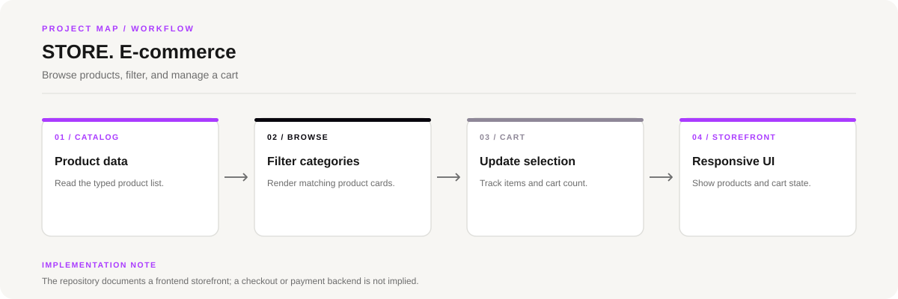

# STORE. E-commerce Store

A responsive storefront built with React and TypeScript. Product cards are rendered from typed data, category filters narrow the catalogue, and cart interactions update the UI.

**Stack:** React, TypeScript, Vite, Bootstrap, CSS



## Features

- Product catalogue driven by `src/data/products.ts`
- Category filtering for electronics, fashion, and accessories
- Interactive cart count
- Responsive layout and product-card transitions

## Run locally

Prerequisites: Node.js 18+ and npm.

```bash
git clone https://github.com/chyk2468/E-Commers-webpage.git
cd E-Commers-webpage
npm install
npm run dev
```

Useful scripts:

- `npm run dev`: development server
- `npm run build`: production build
- `npm run preview`: preview the build
- `npm run lint`: lint source files

## Structure

- `src/App.tsx`: main storefront behavior
- `src/data/products.ts`: product list and TypeScript type
- `src/App.css` and `src/index.css`: styling and theme
- `public/`: static assets

## Scope

This repository currently documents a client-side shopping interface. Do not assume product persistence, account management, payment processing, or order fulfilment unless those are separately implemented.
