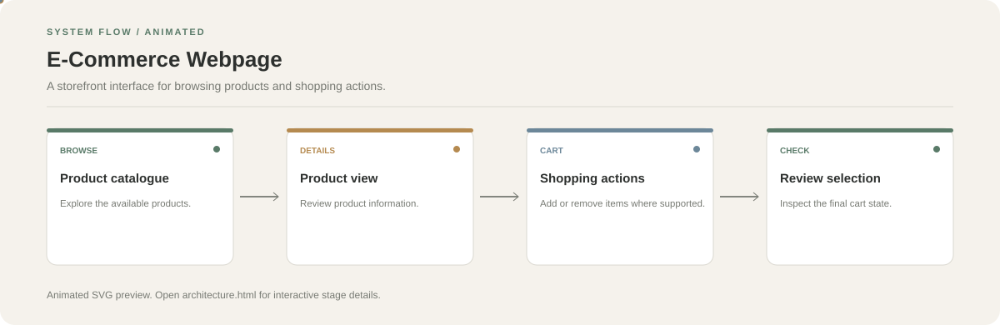

# E-Commerce Webpage

**A storefront interface for browsing products and shopping actions.**

[](https://github.com/chyk2468/E-Commers-webpage)

## 1. Project Title & Tagline

A storefront interface for browsing products and shopping actions.

## 2. Problem Statement

An online storefront needs a clear path from product discovery to cart actions. This project demonstrates the front-end pieces of that shopping experience.

## 3. Project Preview

Add a real screenshot, GIF, or public demo showing the current implementation.

[Open interactive architecture](architecture.html)

## 4. Overview

This repository is organised around a small sequence of input, processing, and output stages. Use the code and configuration files to verify which stages are currently implemented.

## 5. Key Features

- Browse product listings.
- Inspect product information.
- Use the shopping interface and cart interactions where implemented.
- Navigate a responsive storefront layout.

## 6. Architecture / Workflow



Open the [interactive architecture explorer](architecture.html) to select a stage and inspect its role.

## 7. Tech Stack

See the repository package and source files for the exact frontend framework and dependencies.

## 8. Installation & Setup

```bash
git clone https://github.com/chyk2468/E-Commers-webpage.git
cd E-Commers-webpage
```

Install dependencies if a package manifest is present, then run the documented development command.

## 9. Usage

Start the frontend, browse the product cards, and test each shopping interaction. Treat payment, authentication, and order submission as unavailable unless backed by implemented services.

## 10. Project Structure

Start with the main HTML or application entry point, then inspect product components, styles, assets, and cart logic.

## 11. Results & Demo

Add a screenshot of the product grid and cart state, and link a live demo if deployed.

## 12. Future Enhancements

- Add accessible product filtering and sorting.
- Persist cart state across reloads.
- Connect a secure backend for inventory and orders if needed.
- Add responsive and interaction tests.

## 13. License

Check the repository and asset licences before reusing the storefront code or images.
